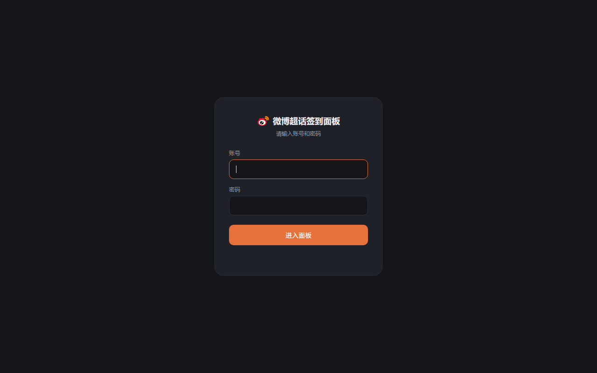
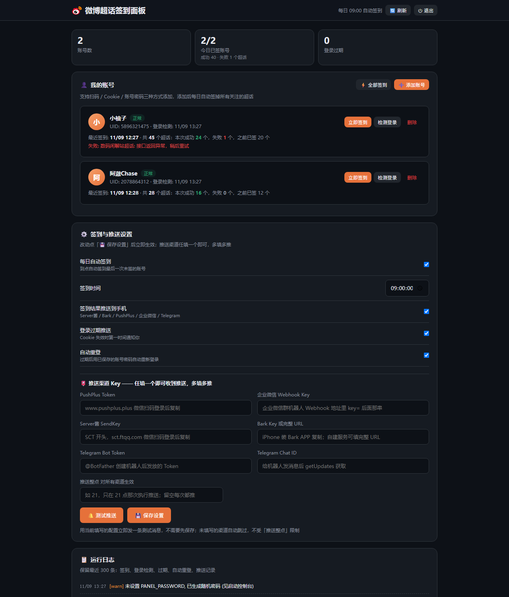
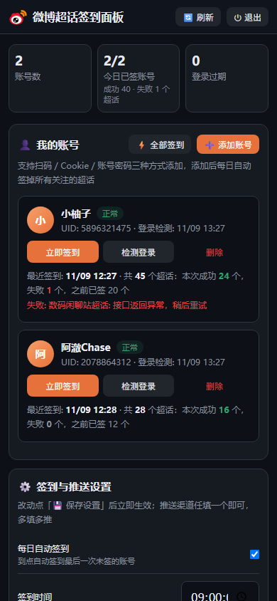

# weibo-chaohua-checkin

微博超话自动签到 —— 本地 / Docker 自托管版，带 Web 管理界面、扫码登录与多渠道推送通知。

在自己服务器 / NAS 上用 Docker 一键部署，网页里扫码添加账号即可长期自动签到，签到结果和登录过期实时推送到手机。

> 核心签到接口与思路来自以下开源项目，特此感谢：
> - [IKUN2788/Weibo-chaohua-Sign-in-Plug](https://github.com/IKUN2788/Weibo-chaohua-Sign-in-Plug)（`m.weibo.cn` 超话签到接口来源）
> - [IKUN2788/weibochaohuaqiandao](https://github.com/IKUN2788/weibochaohuaqiandao)（扫码登录思路）
> - [kuku3863/sign_weibo_chaohua](https://github.com/kuku3863/sign_weibo_chaohua)（多账号 + 推送思路）
>
> 本项目在其基础上封装了 Web 管理界面、多账号调度、推送通知与 Docker 化部署。

---

## ✨ 功能特性

- **Web 管理界面**：账号密码登录（凭据由部署环境变量配置），整站页面与 API 均受保护，适合公网部署；手机 / 电脑浏览器自适应
- **三种账号添加方式**：
  - 📷 **扫码登录**：页面显示微博官方二维码，微博 APP「扫一扫」后自动轮询并保存 Cookie，全程无需抓包
  - 📋 **粘贴 Cookie**：粘贴已有 Cookie，自动校验有效性后保存
  - 🔑 **账号密码**：实验性直登，可勾选「记住密码」用于后续自动重登
- **多账号管理**：逐个添加多个微博账号，独立签到、独立登录检测、独立删除，支持昵称展示
- **每日定时签到**：到点自动签掉所有关注的超话（接口分页拉取 `100803_-_followsuper` 列表 + 逐个签到，内置随机间隔防风控）；启动时若错过当天时间点自动补签
- **签到结果推送**：Server酱 / Bark / PushPlus / 企业微信机器人 / Telegram **多渠道同时推送**；推送内容含汇总（共几个超话、之前已签、本次成功、失败）+ 失败明细
- **登录过期推送**：每 6 小时例行检测 + 每次签到前检测，Cookie 失效第一时间推送提醒
- **自动重登（尽力而为）**：保存过密码的账号过期后自动尝试密码重登，成功/失败都会推送；失败时回退为扫码提醒
- **执行日志**：网页内查看最近 300 条记录（签到 / 检测 / 过期 / 重登 / 推送 / 设置变更）
- **测试推送**：填完 Key 一键发送测试消息，逐渠道反馈成功 / 失败，不用等第一次签到才发现配置错误

## 🖼️ 界面预览

| 登录页 | 管理后台 | 手机端 |
| --- | --- | --- |
|  |  |  |
| 账号密码登录，微博品牌图标 | 账号、签到统计、推送设置、运行日志 | 自动切换为单列布局，按钮加大易点 |

> 截图存放在 `docs/` 目录，可自行补充替换。

## 🚀 快速开始（Docker Compose）

镜像由 GitHub Actions 自动构建并发布到 GitHub Container Registry（首次 Action 运行成功后可拉取），**拉取即用，无需在服务器上构建**：

```yaml
services:
  weibo-checkin:
    image: ghcr.io/ranqingwen/weibo-chaohua-checkin:latest
    container_name: weibo-checkin
    restart: unless-stopped
    ports:
      - "8787:8787"     # 左边是宿主机端口，可自行修改
    environment:
      - PANEL_USER=admin        # ⚠️ 面板登录用户名，公网部署必改
      - PANEL_PASSWORD=请改成你的强密码   # ⚠️ 面板登录密码，公网部署必改
      - TZ=Asia/Shanghai        # 时区，定时签到按此时区执行
    volumes:
      - ./data:/app/data        # 数据持久化：账号 Cookie、密码、设置、日志都在这里
```

```bash
docker compose pull && docker compose up -d
```

访问 `http://服务器IP:8787`，使用 `PANEL_USER` / `PANEL_PASSWORD` 登录，点「➕ 添加账号」扫码即可。

### 本地构建部署

无法访问 ghcr.io、或想修改代码自用时，用项目自带的 `docker-compose.yml` 本地构建（把 `image:` 换成 `build: .`）：

```bash
git clone https://github.com/ranqingwen/weibo-chaohua-checkin.git
cd weibo-chaohua-checkin
docker compose up -d --build
```

也可以将仓库 zip 上传到服务器解压后在目录内执行同样的命令（群晖 Container Manager、威联通 Container Station 等可视化工具选择该路径创建编排同理）。

### 本地运行（Windows / Linux，无需 Docker）

```bash
pip install -r requirements.txt
python app.py        # Windows 可直接双击 start.bat
```

启动后访问 `http://127.0.0.1:8787`。

## ⚙️ 配置说明

### 环境变量（docker-compose.yml）

| 变量 | 说明 |
| --- | --- |
| `PANEL_USER` | 面板登录用户名（默认 `admin`，**公网必改**） |
| `PANEL_PASSWORD` | 面板登录密码（**公网必改**；未设置时启动会生成随机密码打印在日志里，仅应急用） |
| `TZ` | 时区，默认 `Asia/Shanghai`，定时签到与推送整点均按此时区 |

### 网页配置项

| 配置 | 说明 |
| --- | --- |
| 每日自动签到 + 签到时间 | 到点自动签掉所有未签账号，默认 09:00；错过时间点重启会自动补签 |
| 签到结果推送到手机 | 勾选后每次签到完成推送汇总（共 X 个超话、之前已签 Y、本次成功 Z、失败 W + 明细） |
| 登录过期推送 | Cookie 失效时立即推送提醒，避免长时间断签 |
| 自动重登 | 保存过密码的账号过期后自动尝试密码重登（实验性，可能被风控） |
| 推送渠道 Key | Server酱 SendKey（[sct.ftqq.com](https://sct.ftqq.com/) 微信扫码后复制）/ Bark Key 或完整 URL（iPhone 装 Bark APP 复制）/ PushPlus Token（[pushplus.plus](https://www.pushplus.plus)）/ 企业微信群机器人 Webhook / Telegram Bot Token + Chat ID；**多填多推** |
| 推送整点 | 可选，填 `21` 表示只在 21 点那次执行推送，留空每次都推；对所有渠道生效 |
| 🔔 测试推送 | 用当前填写值立即发送测试消息（无需先保存、不受推送整点限制），逐渠道反馈结果 |

## 🔄 关于「自动登录」的说明

微博登录凭证（SUB Cookie）有效期约 30 天，**官方没有免凭证续期接口**，本项目采用三层策略尽量减少手动操作：

| 层级 | 机制 | 效果 |
| --- | --- | --- |
| 1 | 例行保活检测（每 6 小时 + 签到前） | 及时发现失效，避免长时间断签 |
| 2 | 密码自动重登（需添加账号时保存密码） | 过期后自动重新登录，全程无感 |
| 3 | 失效推送 + 扫码提示 | 密码重登失败（风控/验证码）时第一时间通知你重新扫码 |

## 🔒 公网部署安全建议

- 务必修改 `PANEL_USER` / `PANEL_PASSWORD`，不要使用默认值
- 建议通过 Nginx / Caddy 反向代理套一层 HTTPS 后再暴露公网
- 登录会话 30 天有效，改密码 / 环境变量后重启容器即可使旧会话失效
- 所有敏感数据（Cookie、密码、设置）仅保存在服务器本地 `data` 目录，不上传任何第三方；**请勿把 `data/` 目录提交到 Git 或分享给他人**

## ❓ 常见问题

- **二维码获取失败 / 扫码后无反应？** 多为微博接口临时抖动，点重新获取再试；确认用微博 APP（不是其他 App）的扫一扫。
- **签到显示 0 个超话？** 确认账号已关注超话，并在手机微博「我的超话」里能正常看到列表。
- **签到失败较多？** 微博接口有频率限制，本项目已内置随机间隔；失败通常是风控或接口调整，稍后重试即可。
- **推送收不到？** 先点「🔔 测试推送」逐渠道排查；Server酱免费版每天有条数限制，Bark 需注意 iOS 通知权限。
- **登录过期了怎么办？** 收到过期推送后打开面板，删除该账号重新扫码即可；保存过密码的账号会先自动重登。
- **密码重登总失败？** 微博对高频密码登录会触发验证码/风控，属正常现象，回退扫码即可，密码重登只是「尽力而为」的补充手段。

## ⚠️ 免责声明

本项目仅供学习交流与个人效率工具使用，请勿用于任何商业或非法用途。所有接口归微博平台所有，签到行为可能违反微博用户协议，请自行评估风险并合理控制频率，账号相关的一切问题概不负责。使用本项目产生的一切后果由使用者自行承担。

## 🙏 致谢

- 超话签到接口：[IKUN2788/Weibo-chaohua-Sign-in-Plug](https://github.com/IKUN2788/Weibo-chaohua-Sign-in-Plug)
- 扫码登录思路：[IKUN2788/weibochaohuaqiandao](https://github.com/IKUN2788/weibochaohuaqiandao)
- 多账号与推送思路：[kuku3863/sign_weibo_chaohua](https://github.com/kuku3863/sign_weibo_chaohua)
- 本项目新增部分（Web 管理界面、多账号调度、自动重登、推送、Docker 化）：[ranqingwen](https://github.com/ranqingwen)

## 📄 License

[MIT](LICENSE)
